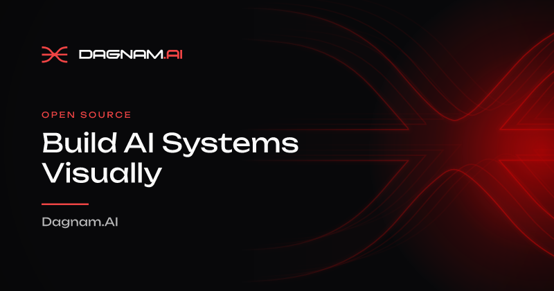
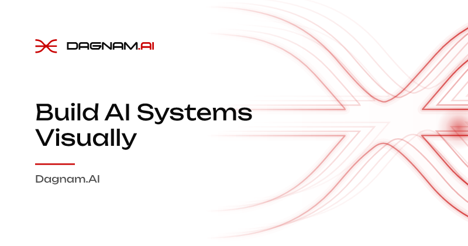
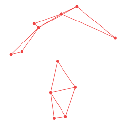
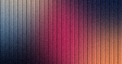
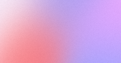
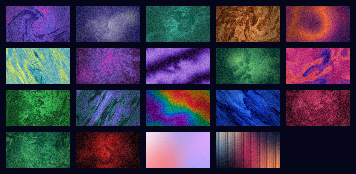
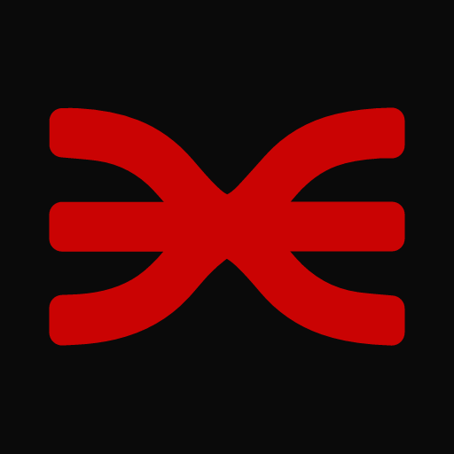
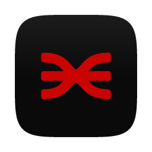
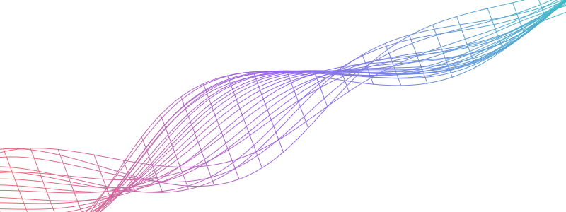
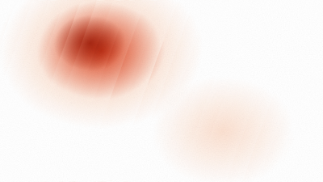

# A tour of `@dagnam/vis`

This page shows what the package makes, with the commands that made it. Every command below was run in this repo and every image is its real output, stored in [`docs/demo/`](docs/demo/). The images are small on purpose (240 px fields, 400 px covers), so a real export at 1200 x 630 is sharper than what you see here.

The CLI runs as `npx dag-vis ...` once the package is installed. In this repo it was run as `node bin/dag-vis.mjs ...` after `npm run build`; the output is the same. The paths are the ones used for these images, so use your own.

## Install

```sh
npm i @dagnam/vis            # the browser-safe root entry, nothing native
npm i @resvg/resvg-js        # only to render PNGs: the CLI, favicons, renderPng
```

Node 22 or newer. Text in PNGs uses the fonts bundled in the package (Inter, Unbounded, Moonhouse), so output does not depend on the machine's fonts.

## What you get

| kind of output     | command                                          | file                                                       |
| ------------------ | ------------------------------------------------ | ---------------------------------------------------------- |
| social (OG) card   | `dag-vis og --title ... --out f.png`             | [og.png](docs/demo/og.png)                                 |
| brand background   | `dag-vis background --palette ocean --out f.png` | [background.png](docs/demo/background.png)                 |
| gradient from JSON | `dag-vis gradient --spec s.json --out f.png`     | [gradient.png](docs/demo/gradient.png)                     |
| pattern tile       | `dag-vis pattern --spec s.json --out f.svg`      | [pattern.svg](docs/demo/pattern.svg)                       |
| field still        | `dag-vis export lunar --out f.png`               | [field-lunar.png](docs/demo/field-lunar.png)               |
| field animation    | `dag-vis export fluid-dawn --out f.gif --loop`   | [field-fluid-dawn.gif](docs/demo/field-fluid-dawn.gif)     |
| contact sheet      | `dag-vis sheet --out f.png`                      | [sheet.png](docs/demo/sheet.png)                           |
| favicon set        | `dag-vis favicons --out DIR`                     | [favicon-icon-512.png](docs/demo/favicon-icon-512.png)     |
| macOS app icon     | `dag-vis app-icon --out DIR`                     | [app-icon-256.png](docs/demo/app-icon-256.png)             |
| cover, five looks  | `coverSvg({ look })` (library)                   | [cover-ember.svg](docs/demo/cover-ember.svg) and four more |
| chapter of lessons | `coverSvg({ family, index, count })` (library)   | [lesson-1.svg](docs/demo/lesson-1.svg) to `lesson-4.svg`   |
| social card, cover | `ogCard({ cover: coverLook(...) })` (library)    | [og-cover.png](docs/demo/og-cover.png)                     |
| ribbon             | `ribbon({ ... })` (library)                      | [ribbon.svg](docs/demo/ribbon.svg)                         |

## The CLI

```sh
npx dag-vis --help
```

```text
Dagnam visuals from the command line (dag-vis <command> [options])

  dag-vis og --title T [--subtitle S --eyebrow E --footer F --theme dark|light --w 1200 --h 630] --out f.(svg|png)
  dag-vis background --w W --h H [--focus x,y --scale N --palette red|mono|stripes|ocean|ember] --out f.(svg|png)
  dag-vis gradient --spec spec.json [--w W --h H] --out f.(svg|png)
  dag-vis pattern --spec spec.json --out f.(svg|png)
  dag-vis favicons --out DIR [--background C --color C]
  dag-vis app-icon --out DIR [--background C --color C]
  dag-vis export <preset|spec.json> --out FILE [--format F] [--w N --h N | --size NAME]
                 [--fps N --duration S --loop] [--quality Q] [--t S] [--alpha] [--poster FILE]
  dag-vis presets
  dag-vis sheet --out f.png [--tile 300x170 --gap 32 --columns 4]

For og, background, gradient and pattern an --out must end in .svg or .png (any
case), or the command exits 1 and writes nothing; .png is rasterised with the
bundled fonts (needs @resvg/resvg-js), .svg is written as is. favicons and
app-icon take a directory as --out: favicons writes favicon.ico, favicon.svg,
apple-touch-icon.png, icon-192.png, icon-512.png, icon-maskable-512.png and
site.webmanifest; app-icon writes the macOS app icon (a squircle plate on a
transparent 1024 canvas) as app-icon.svg, app-icon-<16|32|64|128|256|512|1024>.png
and app-icon.icns. Both draw the mark in the brand's deep red unless --color is
given; --background (opaque) is the tile, or the plate. These commands and sheet
write atomically (a temp file renamed over the target, so an existing file is
replaced even if read-only, and the new one gets the default mode) and create
missing parent directories.
Numbers are plain decimals (600, 0.5); --focus is x,y in 0..1.
Options take "--name value" or "--name=value" (use the second form for a value
that starts with "--"). A spec is a JSON object in a file of at most 1 MiB. To
rasterise a gradient spec whose overlay has an image, give the image as a
raster data: URI (data:image/png, jpeg, gif or webp; a URL, a path or an SVG
data: URI cannot be rendered to PNG; SVG output keeps it as is).

export renders a preset (dag-vis presets lists them) or a spec file ending in
.json: a field (flow, fluid, fluted over either), gradient or ribbon spec.
The format is the --out extension (png jpg jpeg webp avif svg gif apng mp4
webm) or --format, which also takes png-seq (then --out is the folder that
receives frame-00000.png and so on). The size is --size og|square|story|
wallpaper|4k|header or --w and --h in whole pixels (default og, 1200x630).
Animations take --fps (1..60, default 30), --duration in seconds (default 6),
--loop (a seamless loop), --alpha (webm and apng) and --poster FILE (frame 0 as
a PNG). Stills take --t, the second to draw; --loop with --duration picks the
frame an animation of that length shows. --quality is 0..1 (default 0.8) and
applies to jpeg, webp, avif, mp4 and webm only. jpg, webp and avif stills and
apng, mp4 and webm animations need ffmpeg on the PATH (or its path in
DAG_VIS_FFMPEG); png, svg, gif and png-seq do not. An option that does not apply
to the chosen format is an error. export writes through a temp file and a
rename and does not create the folder of --out (png-seq creates its own
folder); sheet --out must end in .png and creates missing folders like the
commands above. presets prints one name and kind per line, in the order of the
sheet, which draws every preset in a grid.
Warnings (a GIF wider than 800 px or faster than 50 fps) go to stderr and the
exit status stays 0.
Exit status 0 on success, 1 on any error (one line on stderr).
```

There is no `cover` subcommand: covers are a library call, shown further down.

### An OG card

```sh
npx dag-vis og --title "Build AI Systems Visually" --subtitle "Dagnam.AI" \
  --eyebrow "Open source" --w 800 --h 420 --out docs/demo/og.png
npx dag-vis og --title "Build AI Systems Visually" --subtitle "Dagnam.AI" \
  --theme light --w 800 --h 420 --out docs/demo/og-light.png
```




### A background, a gradient and a pattern

```sh
npx dag-vis background --w 900 --h 300 --focus 0.8,0.5 --palette ocean --out docs/demo/background.png
npx dag-vis gradient --spec docs/demo/gradient-spec.json --w 600 --h 315 --out docs/demo/gradient.png
npx dag-vis pattern --spec docs/demo/pattern-spec.json --out docs/demo/pattern.svg
```

The two specs are [gradient-spec.json](docs/demo/gradient-spec.json) (`{ "kind": "linear", "angle": 135, "stops": [...] }`) and [pattern-spec.json](docs/demo/pattern-spec.json) (`{ "kind": "dagMesh", "density": 12 }`).




### Field presets

`dag-vis presets` lists 19 presets, one `name<TAB>kind` per line: `violet-dusk`, `lunar`, `lagoon`, `bronze`, `sunset-ring`, `citrus-mist`, `orchid`, `lilac-wave`, `forest-glow`, `rose`, `emerald`, `glacier`, `rainbow-band`, `cobalt`, `crimson`, `pine`, `brand` (all `flow`), then `fluid-dawn` (`fluid`) and `fluted-ember` (`fluted`).

```sh
npx dag-vis export lunar --out docs/demo/field-lunar.png --w 240 --h 126
npx dag-vis export fluted-ember --out docs/demo/field-fluted-ember.png --w 240 --h 126
npx dag-vis export fluid-dawn --out docs/demo/field-fluid-dawn.png --w 240 --h 126
npx dag-vis export docs/demo/my-field.json --out docs/demo/field-custom.png --w 240 --h 126
npx dag-vis export fluid-dawn --out docs/demo/field-fluid-dawn.gif --w 160 --h 84 --fps 8 --duration 2 --loop
```

Left to right: `lunar` (flow), `fluted-ember` (fluted), `fluid-dawn` (fluid) and your own spec, [my-field.json](docs/demo/my-field.json) (a flow field in the brand reds).






A seamless two second loop of `fluid-dawn` (a GIF, built in; mp4, webm, apng, jpg, webp and avif need ffmpeg on the PATH, which this machine did not have, so they are not shown):


Sizes have names too: `--size og|square|story|wallpaper|4k|header`.

### A contact sheet of every preset

```sh
npx dag-vis sheet --out docs/demo/sheet.png --tile 64x36 --gap 6 --columns 5
```



### Favicons and the app icon

```sh
npx dag-vis favicons --out public
npx dag-vis app-icon --out build/icons
```

`favicons` wrote `favicon.ico`, `favicon.svg`, `apple-touch-icon.png`, `icon-192.png`, `icon-512.png`, `icon-maskable-512.png` and `site.webmanifest`. `app-icon` wrote `app-icon.svg`, `app-icon-16.png` up to `app-icon-1024.png` (16, 32, 64, 128, 256, 512, 1024) and `app-icon.icns`. Two of them:




## The library

The root entry is pure and browser-safe: every generator returns a string. The numbers below come from running these calls.

### Gradients and the brand background

```ts
import {
  brandBackground,
  freeformPalette,
  gradient,
  gradientSvg,
} from "@dagnam/vis";

gradient({ kind: "linear", angle: 90, stops: ["#ef4444", "#10abba"] }).css;
// "background: linear-gradient(90deg, #ef4444 0%, #10abba 100%);"

gradient({ kind: "freeform", points: freeformPalette("dawn") }).css;
// "background: radial-gradient(circle 604.8px at 85% 90%, rgba(59, 130, 246, 0.749) 0%, ..."

gradientSvg({ kind: "radial", stops: ["#ef4444", "#10abba"] }).length; // 341 characters of SVG
brandBackground({ width: 1200, height: 630 }); // an SVG string, 24817 characters
```

Gradient kinds: `linear`, `radial`, `conic`, `mesh`, `aurora`, `banded`, `layers`, `freeform`, `glows` and `fluted`.

### Cards and covers

```ts
import { ogCard, ribbon } from "@dagnam/vis";

ogCard({ title: "Build AI Systems Visually", subtitle: "Dagnam.AI" }); // 1200 x 630 SVG, 28765 characters
ribbon({ width: 800, height: 300, lines: 24, mesh: true }); // the wave-mesh ribbon
```



A cover is one input, `{ family, item, theme, variant }`, and a `look`. `COVER_LOOKS` lists the five looks: `ember,aurora,contour,silk,halftone`. This is [demo-images.mjs](scripts/demo-images.mjs) in miniature:

```ts
import { COVER_LOOKS, coverSvg } from "@dagnam/vis";

for (const look of COVER_LOOKS) {
  const svg = coverSvg({
    family: "tag:ai",
    item: "my-post",
    theme: "dark",
    variant: "card",
    look,
  });
  // write `svg` to cover-<look>.svg
}
```

The five looks, in order: `ember` (a glow with fine lines), `aurora` (wide glows), `contour` (topographic rings), `silk` (fluted glass) and `halftone` (a dot grid).


The light theme, here with `silk` (the glow is nested and the texture stays inside it):



A chapter or lesson set: give every lesson the chapter's `family` and `count`, and its own `index`. The lessons of one family share a look (this family derives `halftone`) and each lesson's glow lands in a different place. Pin `look` once per chapter if you want a chosen one, and do not pass `region` per lesson.

```ts
for (let index = 0; index < 4; index++) {
  coverSvg({
    family: "course:intro",
    item: `lesson-${index + 1}`,
    index,
    count: 4,
    theme: "dark",
    variant: "card",
  });
}
```


`coverLook` returns the parts of a look (its gradient spec, texture, title scrim and contrast), and `ogCard` takes one as its `cover` for the social card, with the title in Moonhouse and the excerpt in Unbounded:

```ts
import { coverLook, ogCard } from "@dagnam/vis";
import { renderPng } from "@dagnam/vis/node";

const look = coverLook({
  family: "tag:ai",
  item: "my-post",
  theme: "dark",
  variant: "banner",
  look: "aurora",
});
look.look; // "aurora"; `spec`, `texture`, `scrim` and `contrast` come with it
const card = ogCard({
  title: "Building a reasoning model",
  excerpt: "Data, architecture and training on one GPU.",
  cover: look,
});
const png = await renderPng(card, { width: 440 }); // a Buffer
```


### Strict parsers

Stored or typed data should go through a parser first. It throws a `VisError` that names the field, and never clamps:

```ts
import { parseCoverInput, parseFieldPreset } from "@dagnam/vis";

parseFieldPreset("lunar"); // "lunar"
parseCoverInput({ item: "x", theme: "dark", variant: "card", hue: 20 });
// VisError: cover.hue: expected a number in -15..15, got 20
parseFieldPreset("lunarr");
// VisError: field preset: expected one of the known presets, got "lunarr"
//   (known: violet-dusk, lunar, lagoon, bronze, sunset-ring, citrus-mist, orchid,
//    lilac-wave, forest-glow, rose, emerald, glacier, rainbow-band, cobalt, crimson,
//    pine, brand, fluid-dawn, fluted-ember)
```

### Fields on the CPU, and exports from Node

```ts
import { fieldPresets, fieldPresetCatalog, renderField } from "@dagnam/vis";
import { exportAnimation, exportStatic, renderSheet } from "@dagnam/vis/node";

fieldPresetCatalog[0]; // { name: "violet-dusk", label: "Violet dusk", kind: "flow" }
const frame = renderField(fieldPresets["violet-dusk"], {
  width: 1200,
  height: 630,
  t: 0,
  loop: 6,
}); // 1200 x 630 RGBA, a Uint8ClampedArray of 3024000 bytes

await exportStatic(fieldPresets.lunar, {
  width: 240,
  height: 126,
  format: "png",
  out: "lunar.png",
  t: 1.5,
}); // wrote a 74 KB PNG of the frame at 1.5 s

await exportAnimation(fieldPresets["fluid-dawn"], {
  width: 160,
  height: 84,
  format: "gif",
  out: "fluid-dawn.gif",
  fps: 8,
  duration: 2,
  loop: true,
}); // wrote a 122 KB GIF

await exportAnimation(fieldPresets["fluid-dawn"], {
  width: 64,
  height: 36,
  format: "png-seq",
  out: "seq",
  fps: 4,
  duration: 1,
}); // made seq/frame-00000.png to seq/frame-00003.png

renderSheet({ tile: { width: 64, height: 36 }, gap: 6, columns: 5 }); // { data, width: 356, height: 174 }
```

### Animated effects (browser only)

`@dagnam/vis/animate` has WebGL2 and Canvas2D effects (`createDither`, `createPixelBlast`, `createTerminal`, `createGlitch`, `createRibbon`) and `createField`. They need a canvas, so they were not run in this tour. `npm run demo` serves a gallery of them from this repo.

```ts
import { createField, exportCanvas } from "@dagnam/vis/animate";

const handle = createField(canvas, fieldPresets.lunar, {
  loop: { duration: 6 },
});
handle.start(); // draws and animates
handle.renderAt(2); // a deterministic frame at t = 2 s, no clock read
handle.stop(); // pause before exporting
const mp4 = await exportCanvas(handle, { format: "mp4", fps: 30, duration: 6 }); // a Blob
handle.destroy();
```

### React

`@dagnam/vis/react` has `<Gradient>`, `<VisBackground>` and `<FieldPresetPicker>`. `<Gradient>` renders on the server; this is its real output:

```tsx
import { Gradient, VisBackground } from "@dagnam/vis/react";

<Gradient
  spec={{
    kind: "linear",
    angle: 135,
    stops: ["#0f172a", "#e64040"],
    idPrefix: "hero",
  }}
  width={120}
  height={60}
/>;
// <div aria-hidden="true"><svg preserveAspectRatio="xMidYMid slice" style="display:block;width:100%;height:100%"
//   xmlns="http://www.w3.org/2000/svg" width="120" height="60" viewBox="0 0 120 60"><defs>
//   <linearGradient id="hero-g" gradientUnits="userSpaceOnUse" x1="15" y1="-15" x2="105" y2="75">
//   <stop offset="0" stop-color="#0f172a"/><stop offset="1" stop-color="#e64040"/></linearGradient></defs>
//   <rect width="120" height="60" fill="url(#hero-g)"/></svg></div>

<VisBackground effect="dither" options={{ colors: ["#e64040"] }} />;
// on the server: <div style="overflow:hidden"></div> (the canvas is made in an effect, in the browser)
```

`<FieldPresetPicker>` is a browsable list of the 19 presets, drawn with the CPU renderer. See the README for its props.

## Determinism

Same options and seed give the same bytes. SHA-256 of two separate runs of each command, all on this machine:

```sh
for i in 1 2; do npx dag-vis og --title "Build AI Systems Visually" --out a$i.svg; done
for i in 1 2; do npx dag-vis og --title "Build AI Systems Visually" --out a$i.png; done
for i in 1 2; do npx dag-vis export lunar --out l$i.png --w 240 --h 126; done
shasum -a 256 a1.svg a2.svg a1.png a2.png l1.png l2.png
```

```text
24fb1b02b90c31b0371c3be48a86c53d1d0910681382997e7ef532394af41ba3  a1.svg
24fb1b02b90c31b0371c3be48a86c53d1d0910681382997e7ef532394af41ba3  a2.svg
3acf1222f248ca2ade5d59a24ad5ab6ce15cab2fccbbf904b3fef82795d81576  a1.png
3acf1222f248ca2ade5d59a24ad5ab6ce15cab2fccbbf904b3fef82795d81576  a2.png
6e9f70806e220f362bce3470e3d3668875e59739f4e342f17e31956e1d8a4be3  l1.png
6e9f70806e220f362bce3470e3d3668875e59739f4e342f17e31956e1d8a4be3  l2.png
```

In the library the seed is an option. The first 16 hex digits of the SHA-256 of `ogCard({ title: "Hi", seed })`:

```text
seed 5, first run   b53e9761f422e2f7
seed 5, second run  b53e9761f422e2f7
seed 6              c8f9dfbbefb2282e
```

The PNGs are repeatable for a given `@resvg/resvg-js` build (here 2.6.2, one platform), so pin that version if you need byte-identical PNGs across upgrades. SVG and CSS do not depend on it.

## Rebuild these images

```sh
npm ci && npm run build
node scripts/demo-images.mjs   # the library images (covers, lessons, social card, ribbon) and the cover hash check
```

The CLI commands above make the rest. `demo.md` and `docs/demo/` are not part of the npm package (`files` in `package.json` lists only `dist`, `bin` and `NOTICE`), and the images use only the fonts and brand marks already in the repo.
